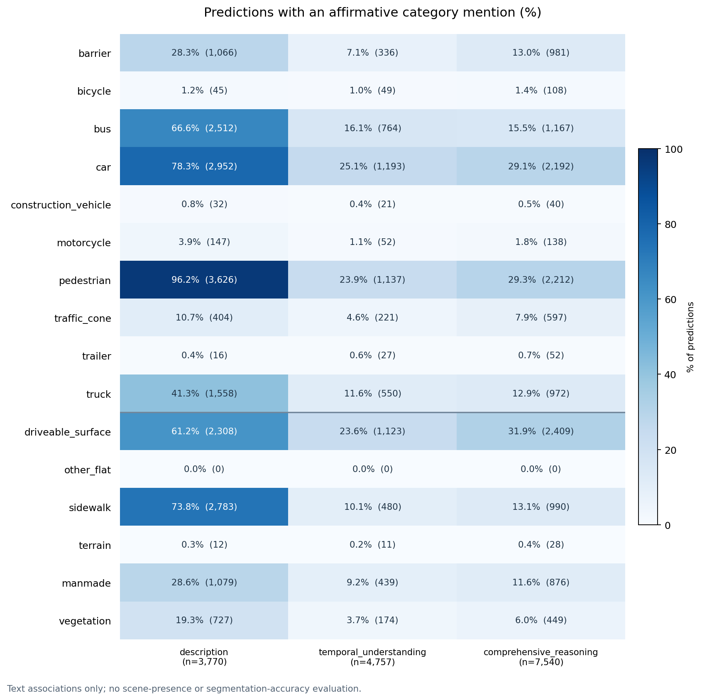

# B3预测内容与nuScenes分割类别的逐条对应分析

分析日期：2026-10-12。输入为用户提供的 predictions.json。只分析 description、temporal_understanding 和 comprehensive_reasoning，共 **16,067 条预测**。

**一条预测对应结果表的一行，保留任务内原始顺序和重复输出。** 类别内序号从1开始，对应源文件 predictions 数组索引加1。原问题和参考答案仅保留为核对字段，类别提取不借用这些字段。

## 判定范围

分析的是生成文本与类别定义的对应关系。采用可复现的词汇、同义词及局部语境规则覆盖全部预测，人工核对典型和边界表达；每条记录保留命中词、上下文及复核原因。不是人工逐条确认所有自然语言语义，也不是场景存在性或分割准确率评测。

官方评测16类为10类Thing和6类Stuff；原始32类中的自车、动物等另记为原始ignore类别。文本中的位置、运动、帧范围和驾驶建议另外列出，不作为新增类别。

| 关系状态 | 含义 |
|---|---|
| 肯定提及 | 文本描写或引用该对象/区域；可包含SUV→car、道路→driveable_surface等语义对应。 |
| 否定存在 | 原文否定对应对象/区域存在或可见，只作用于原句的修饰语、对象、位置和帧范围。 |
| 条件或可能 | 对象存在或类别带条件/可能性，或不同类别由or连接。 |
| 泛指或建议 | 讨论类别活动、路况或驾驶建议，不能单独作为具体实例存在证据。 |
| 未提及 | 没有从预测中取得该类指称；不表示真实场景不存在该类。 |

同一预测的同一类别可在不同句子、实例或帧范围内出现多种状态。肯定与否定并存会保留两者并标记需复核，不强行合并。

## 三类任务的内容特点

| 任务 | 条数 | 至少一个肯定类别 | 同时含肯定Thing和Stuff | 无明确16类提及 | 含风险/建议 |
|---|---:|---:|---:|---:|---:|
| description | 3,770 | 3,770（100.0%） | 3,464（91.9%） | 0 | 198 |
| temporal_understanding | 4,757 | 3,651（76.8%） | 1,157（24.3%） | 1,012 | 264 |
| comprehensive_reasoning | 7,540 | 6,400（84.9%） | 2,636（35.0%） | 983 | 2,030 |

**description：对象和环境一起描述。** 常见组合是行人、汽车、公交车、卡车，加上道路、人行道、建筑和树木。其生成内容通常还能给出左右位置、前后距离、运动状态或帧范围；这些是对象的属性与关系。

**temporal_understanding：更多描述运动和相对变化。** 比如某辆车是否靠近、行人是否横穿、路障是否移动。有些输出仅使用they/it或泛称vehicles，不足以仅从预测确定具体类别；Yes./No.也不会从问题中补全类别。

**comprehensive_reasoning：对象与驾驶影响、风险判断相联系。** 比如靠近的公交车需要保持距离、路障和交通锥提示施工。存在的对象、假设风险中的例举对象以及泛指建议分开记录，避免把“可能出现交通锥”记成已经存在交通锥。

## 官方16类的文本关联频次

下表按“肯定提及”统计，每条预测、每个类别只计一次。类别可共现，因此各类别计数相加会超过预测条数。百分比的分母为该任务的预测总数，不是点数、实例数或场景数。

| 类别 | 类型 | description | temporal_understanding | comprehensive_reasoning |
|---|---|---:|---:|---:|
| barrier（隔离栏/临时路障） | Thing | 1,066（28.3%） | 336（7.1%） | 981（13.0%） |
| bicycle（自行车） | Thing | 45（1.2%） | 49（1.0%） | 108（1.4%） |
| bus（公交车） | Thing | 2,512（66.6%） | 764（16.1%） | 1,167（15.5%） |
| car（汽车/SUV/van） | Thing | 2,952（78.3%） | 1,193（25.1%） | 2,192（29.1%） |
| construction_vehicle（工程车辆） | Thing | 32（0.8%） | 21（0.4%） | 40（0.5%） |
| motorcycle（摩托车） | Thing | 147（3.9%） | 52（1.1%） | 138（1.8%） |
| pedestrian（行人） | Thing | 3,626（96.2%） | 1,137（23.9%） | 2,212（29.3%） |
| traffic_cone（交通锥） | Thing | 404（10.7%） | 221（4.6%） | 597（7.9%） |
| trailer（挂车） | Thing | 16（0.4%） | 27（0.6%） | 52（0.7%） |
| truck（卡车/皮卡） | Thing | 1,558（41.3%） | 550（11.6%） | 972（12.9%） |
| driveable_surface（可行驶表面） | Stuff | 2,308（61.2%） | 1,123（23.6%） | 2,409（31.9%） |
| other_flat（其他平坦区域） | Stuff | 0（0.0%） | 0（0.0%） | 0（0.0%） |
| sidewalk（人行道/步行道） | Stuff | 2,783（73.8%） | 480（10.1%） | 990（13.1%） |
| terrain（自然地表/低矮草地） | Stuff | 12（0.3%） | 11（0.2%） | 28（0.4%） |
| manmade（建筑/人工结构） | Stuff | 1,079（28.6%） | 439（9.2%） | 876（11.6%） |
| vegetation（树木/灌木/植被） | Stuff | 727（19.3%） | 174（3.7%） | 449（6.0%） |

高频类别集中在pedestrian、car、bus、truck、driveable_surface和sidewalk。construction_vehicle、trailer、bicycle、terrain较少。规则未取得可靠的other_flat指称；这只说明当前生成文本没有清楚提及，不能推断对应场景没有此类点。

## 逐条案例

| 任务与序号 | 预测原文 | 对应关系 |
|---|---|---|
| description #1 | The LiDAR sequence captures an urban environment with the ego vehicle moving forward along a road lined with buildings and trees. A pedestrian is visible on the right sidewalk, and a car is moving away in the distance. The sequence shows the ego vehicle advancing, with the pedestrian and car becoming more distant over time. | 对象：car（汽车/SUV/van）、pedestrian（行人）；区域：driveable_surface（可行驶表面）、sidewalk（人行道/步行道）、manmade（建筑/人工结构）、vegetation（树木/灌木/植被）；原始ignore：vehicle.ego（肯定提及）；关系/属性：远离/距离增大、向前/向后运动 |
| description #605 | At frame 17, the ego vehicle is positioned in an urban street with parked cars and SUVs on both sides, and a construction site visible on the right. A pedestrian is visible on the left sidewalk, and a construction vehicle is parked on the right, with a construction worker near it. | 对象：car（汽车/SUV/van）、construction_vehicle（工程车辆）、pedestrian（行人）；区域：driveable_surface（可行驶表面）、sidewalk（人行道/步行道）；原始ignore：vehicle.ego（肯定提及）；泛称/待定：construction site；时间：frame 17；关系/属性：静止/停放 |
| temporal_understanding #5 | No, the barriers remain static from frame 000 to frame 014. | 对象：barrier（隔离栏/临时路障）；时间：from frame 000 to frame 014；关系/属性：静止/停放 |
| temporal_understanding #241 | No, there are no pedestrians visible. | 否定存在：pedestrian |
| temporal_understanding #573 | Yes. | 未明确给出官方16类，无法仅从预测确定具体分割类别 |
| comprehensive_reasoning #7497 | The driver must be aware of the presence of pedestrians and vehicles, especially the bus and cars, and the potential for obstacles like traffic cones or barriers, ensuring safe navigation through the urban or suburban street. | 对象：bus（公交车）、car（汽车/SUV/van）、pedestrian（行人）；区域：driveable_surface（可行驶表面）；条件/可能：barrier、traffic_cone；泛称/待定：vehicles、obstacles；含风险判断/驾驶建议；该部分不是分割类别 |
| comprehensive_reasoning #5096 | The concrete mixers remain stationary, posing no immediate navigating challenges but requiring awareness of their presence. | 未明确给出官方16类，无法仅从预测确定具体分割类别；泛称/待定：concrete mixers；关系/属性：静止/停放；含风险判断/驾驶建议；该部分不是分割类别 |

## 必须保留的类别边界

- ego vehicle对应原始vehicle.ego，官方评测忽略；不会据此额外增加car。
- SUV和通常所指的van按官方个人用车定义关联car；pickup关联truck。车辆的真实用途仍需场景标注确认。
- construction site/zone只是施工情境，不能推出construction_vehicle。明确工程车辆或excavator可以对应工程车辆；equipment/concrete mixer保持候选关系，避免将静态设备、搅拌车和工程车辆混为一类。
- buildings、walls、traffic lights/signals等关联manmade；不是额外增加“建筑”“红绿灯”评测类。未指明类型的structure保留为泛称。
- cyclist关联bicycle，motorcyclist关联motorcycle；不会自动另加pedestrian实例。
- no movement/No, ... remain static否定的是运动，不是否定对象存在。no moving pedestrians仅否定正在运动的行人，不证明场景中整类行人不存在。
- if a pedestrian crosses是条件对象；已经描述的行人could cross属于行为可能性，应保留已提及对象。
- roadside、lane change、construction、city/urban等不能只按子字符串拆出不存在的类别。草地按terrain语义关联，但点级标注中的高度界限没有由文本验证。

## 不明确内容与后续使用

共有 **1,995 条**预测没有明确提供官方16类指称；其中可包括自车、泛称车辆、施工情境、代词或简短回答。这些记录已完整保留。

共有 **2,680 条**在规则分析中标记了复核原因，包括多种存在状态并存、条件/泛指表达、类型不明设备、草地边界、骑行者关联或缺少具体类别。这个标记表示语义判定的复核需要，不表示模型输出错误。

用于后续指代分割数据筛选时，Thing肯定提及可以提供目标类别候选，位置和运动可提供描述约束；Stuff肯定提及可以提供区域候选。仍需把预测关联到真实scene/sample和对象实例或点级区域，才能生成有效的分割监督。当前文件没有提供这种定位或掩码，不能直接从文本确定GT实例、点集、漏分或误分。

## 交付文件

- B3预测_nuScenes类别逐条分析.xlsx：汇总、三个任务的逐条表、类别与判定说明，可筛选。
- 全部预测_逐条类别对应.csv：全部16,067行；另有三个任务各自的CSV。
- 16类存在关系矩阵.csv：每条预测对16类的状态，含未提及。
- 需复核预测.csv：保留复核原因的记录子集。
- 逐条分析.jsonl：原始预测、命中词、字符范围、原句上下文和结构化状态。

## 数据核验与复现

已逐条核对预测、问题、参考答案的顺序与内容；核对证据字符范围能回指预测原文；从逐条记录独立重算各类别频次；核对CSV和16类矩阵的记录数。源文件未修改。

源文件SHA-256：`e5d1fe81ede865ecf496b21c1d67185dd8aacc8fea891b598f74c363ad637d89`。重复生成文本仍按原始条目计数；未进行去重或类别均衡处理。

## 官方依据

- [官方16类及ignore映射](https://github.com/nutonomy/nuscenes-devkit/blob/master/python-sdk/nuscenes/eval/lidarseg/utils.py)
- [官方Thing/Stuff划分](https://github.com/nutonomy/nuscenes-devkit/blob/master/python-sdk/nuscenes/eval/panoptic/utils.py)
- [对象类别定义：SUV/van/施工车辆/骑行者](https://github.com/nutonomy/nuscenes-devkit/blob/master/docs/instructions_nuscenes.md)
- [地面/植被/人工结构定义](https://github.com/nutonomy/nuscenes-devkit/blob/master/docs/instructions_lidarseg.md)
